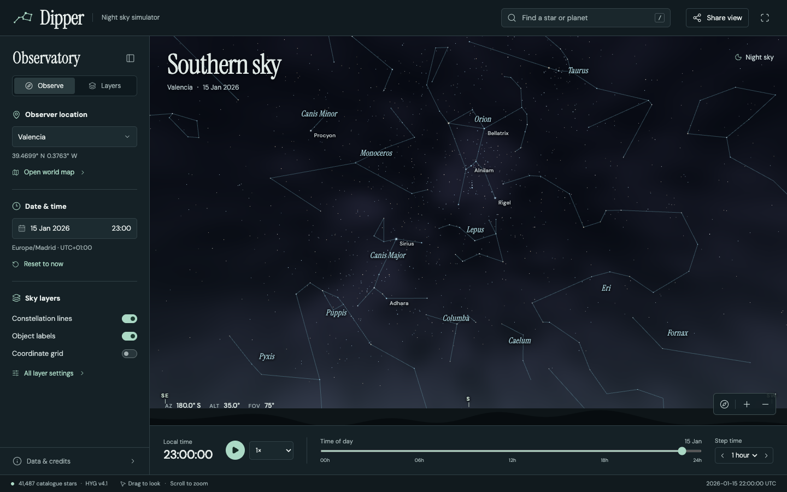

# Dipper

Explore the sky from an observer on Earth. Dipper bundles 41,487 HYG stars and calculates the Sun, Moon and seven planets locally.

```sh
cd dipper
bun install --frozen-lockfile
bun run dev
```

Open **http://localhost:3014/**. Bun 1.4.4 and a WebGL 2 browser were used for verification. For the full demo collection, run `./run-all.sh` at the repository root and open **http://localhost:3000/portal/**. Dipper uses the launcher’s base port + 14.



## First observation

The first visit opens a paused winter night in Valencia, 15 January 2026 at 23:00 CET. Search for **Sirius** and press Enter to centre it. Open **Observer location**, pick **Cape Town**, and apply. The UTC instant stays fixed while Sirius changes altitude and azimuth. **Reset to now** sets the actual current instant. Returning visits restore the last site and observation time. **Share view** captures the observer, UTC instant, heading and field of view in the URL.

- Drag the sky to look around. Scroll or pinch to zoom from 100° to 10°. Click an object for its coordinates, magnitude and source. Click empty sky to clear it.
- With the sky focused, use the arrow keys to turn, **N** to face north, **+ / −** to zoom, and **Space** for playback. Press **/** to search by name, HIP, HD, HYG or a catalogue designation.
- Use the local date/time editor for civil time, or scrub the local day. Back and forward steps support minutes, hours and calendar days. The rate control runs in either direction. The footer always displays UTC.
- Open **Layers** to adjust sky glow, limiting magnitude, extinction, exposure, the Milky Way density map, reference grid, Western constellation lines and asterisms. Disable standard refraction for geometric coordinates.
- For deep zoom, search **Alnilam**, enable **Gaia deep fields** and zoom to 25° or closer. Four local Gaia DR3 tiles cover the 10° × 10° Orion field. Other directions use the full-sky HYG catalogue.
- Use **Data & credits** for attribution, the elevation assumption, and the source revisions.

## Data and static deployment

The shipped binary, name index, overlays, Gaia tiles, fonts and ephemeris code work from local assets. Serve the site over HTTP on localhost or over HTTPS for browser checksum verification. Leaflet loads tiles when the location dialog opens. Coordinate entry, time-zone override and presets continue working if tiles fail. Copy `.env.example` to `.env` to select another tile provider, its attribution, or a default observer.

```sh
bun run build
bun run preview
```

Deploy the contents of `dist/` on a static HTTP server. The standalone development and preview commands accept a `PORT` environment value or `--port` argument.

## Verification and data preparation

```sh
bun test
bun run catalog:validate
bun --bun playwright install chromium
bun run test:e2e
```

Playwright needs its Chromium browser and the platform libraries required by Chromium. On a Linux CI image, `bun --bun playwright install --with-deps chromium` also installs those system dependencies. An existing compatible browser may be supplied through `CHROMIUM_PATH`. Ordinary tests run against bundled fixtures.

```sh
bun run catalog:build                         # fetch and verify pinned HYG if absent
bun run catalog:build /path/to/hygdata_v41.csv
bun run catalog:gaia                          # verify or resume the optional Orion tiles
```

The HYG build accepts `HYG_MAG_LIMIT` (default 8). The shipped release tests use the default cutoff. A failed source download can be recovered by supplying the official CSV with the SHA-256 in the manifest. If a deployed catalogue checksum fails, restore the binary, names and manifest from the same build, then use **Retry catalogue**.

[Scientific accuracy](docs/ACCURACY.md) · [Data provenance](docs/DATA_PROVENANCE.md) · [Tests and performance](docs/TEST_PLAN.md) · [Implementation notes](docs/IMPLEMENTATION_NOTES.md) · [Original specification](Dipper-night-sky-simulator-SPEC.md)
