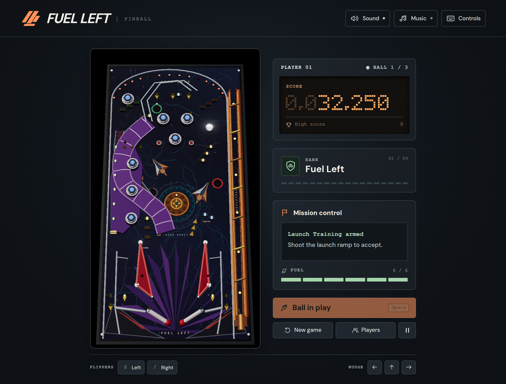

# Fuel Left

A space pinball table for one to four players sharing a keyboard or touchscreen. Each player has three balls, their own mission and nine ranks to climb. The game runs locally in a browser with WebGL 2.



## Run

```sh
cd fuel-left
bun install --frozen-lockfile
bun run dev
```

Open [Fuel Left on port 3013](http://localhost:3013/). Set `PORT` to choose another port. The shared repository launcher assigns Fuel Left the base port plus 13 and lists it in both galleries. The production build is static and can be served from `dist/`.

## Play

Hold **Space** to pull the plunger, then release. A short plunge can earn a skill shot. Reaching the third deployment lamp and falling back pays 75,000 points before the field multiplier. A full plunge clears the crest.

Hit one of the three mission targets beside the purple ramp, then cross its red sensor to accept the selected mission. The panel names the next shot. The amber core shows rank, the cyan ring tracks promotion, and the six green fuel lamps count down during missions. A ramp shot, a completed fuel bank or the bonus lane refills the tank.

| Action | Default keys |
| --- | --- |
| Left and right flippers | Z and /, or left and right Shift |
| Charge and release the plunger | Space |
| Nudge left, right or up | X, period or Up arrow |
| New game | F2 |
| Pause or resume | F3 or Escape |
| View or remap controls | F8 |

Click or touch either half of the table to flip. The on-screen plunger and nudge buttons work with a pointer. Choose **Players** to start a shared game. The five highest scores and custom bindings are saved in the browser on this origin. Sound effects start enabled. Music starts muted.

## Development

```sh
bun test
bun run typecheck
bun run build
bun run preview
```

The Three.js renderer reads a 240 Hz custom simulation. Device events feed the game and pure mission reducer. Physics dimensions, timings, scores and mission payouts live in [the rules constants](src/rules/constants.ts). The renderer generates the table art locally and Web Audio synthesizes its effects and score. Open with `?debug=1` and press P to raise the center post for a physics check.

The supplied [photograph](pinball.jpeg) is a composition reference. [Implementation specification](spec-fuel-left.md)

An original homage to 1990s desktop pinball. Not affiliated with the original publishers.
