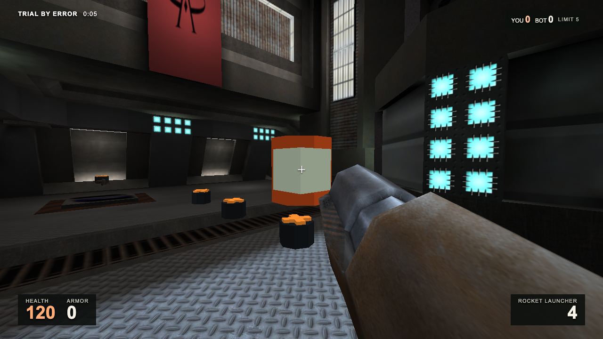

# Temblor

Temblor is a first-person arena shooter for desktop browsers on Linux and macOS. Play a one-on-one match against a local bot in OpenArena’s *Trial by Error*. Collect weapons, health and armor, and score five frags to win. The engine is written in Rust, runs as WebAssembly and draws the arena with WebGPU. The bundled match requires no extra downloads or retail game files.

## Play

Run **`./play`**, open **http://127.0.0.1:8080**, and click **Play** in desktop Chromium with hardware WebGPU. The checked-in release needs only Python 3 to serve it. Any HTTPS static host can serve the contents of `release/`.

From the GPT6 Demos repository root, run `./run-all.sh` and choose **Temblor** in the [preview gallery](http://localhost:3000/portal/). The shared launcher serves the game at base port + 15. To run just that service, use `bun run dev` from this directory and open [localhost:3015](http://localhost:3015/). Set `PORT` to choose another port.

## Where to download free PK3 files

A `.pk3` is a ZIP-format archive for game data. A map’s `.bsp` describes its geometry, lighting and item placement. The textures, shaders and sounds it uses can be in the same PK3 or in companion archives.

| Download | What you get | Use with Temblor |
| --- | --- | --- |
| [Trial by Error — arena.pk3](release/arena.pk3?raw=true) | The self-contained 3.7 MiB OpenArena package shipped with Temblor. | Use this file for a first import. It contains the tested map and all its dependencies. |
| [OpenArena 0.8.8 full download](https://sourceforge.net/projects/oarena/files/openarena-0.8.8.zip/download) | The free OpenArena distribution. Extract the outer ZIP and open the `baseoa/` folder to find its PK3s. | For *Trial by Error*, select the map and companion data archives together. Temblor’s bundled version draws from `pak0`, `pak1-maps`, `pak4-textures` and `pak6-misc`. |
| [OpenArena community PK3 directory](https://download.tuxfamily.org/openarena/autodownload/baseoa/) | Individual map downloads, including [Community Mappack Volume 1](https://download.tuxfamily.org/openarena/autodownload/baseoa/z_oacmp-volume1-v3.pk3). | These are additional maps for OpenArena. Temblor’s current picker lists only `maps/oa_rpg3dm2.bsp` and the retail `maps/q3dm1.bsp`. |

### Import a downloaded arena

1. Start Temblor, click **Play**, then press **Escape** to pause.
2. Click **Load local game files** → **Choose PK3 archives**. For the tested example, select `arena.pk3`. For a split distribution, select all required PK3s in one file selection. Leave each PK3 intact.
3. Choose `maps/oa_rpg3dm2.bsp` and click **Play selected map**. Files are read locally in your browser.

If the picker reports **No supported map found**, the selected archives contain neither supported BSP path. If it names a missing texture, select the map PK3 again together with its companion data packs.

## Browser setup and controls

**Ubuntu and “No WebGPU adapter.”** In Chrome, open `chrome://flags/#enable-vulkan`, set **Vulkan** to **Enabled**, and click **Relaunch**. Reopen Temblor and click **Play**. On Ubuntu 26.04.1 with AMD Radeon Vega graphics and Chrome 158, graphics acceleration was already active and enabling Vulkan made the hardware adapter available. If the message persists, check **Use graphics acceleration when available** in `chrome://settings/system` and the WebGPU diagnostics in `chrome://gpu`.



Fight one bot to five frags in **Trial by Error**. Move with WASD, aim with the mouse, fire with the primary button, jump with Space and crouch with C. Switch weapons with the number row or wheel, hold Tab for scores and press Escape to pause. In **Controls**, choose **Native** (the default) for the display’s physical resolution, or **Performance** to cap rendering at 1,280 pixels wide. Mouse sensitivity and HUD size are the same in both modes. Collect the rocket launcher near the starting corridor and use the pillars for cover. Both actors respawn after a frag. Click **Rematch** on the final score.

| Content | Runtime coverage |
| --- | --- |
| OpenArena `maps/oa_rpg3dm2.bsp` | Real BSP and AAS, four starts, one inline jump pad, shallow and deep water, health, armor, ammunition and spatial ambient speakers. Gauntlet, machinegun, shotgun, grenade launcher, rocket launcher and lightning gun. |
| Character and equipment | OpenArena’s Major uses animated lower, torso and head meshes. All six weapons use textured meshes with authored attachment tags. The bundled actor package loads for local maps as well. |
| Retail `maps/q3dm1.bsp` | Local PK3 import, base and patch precedence, map selection and shared runtime. Retail gameplay acceptance remains open pending an owner's licensed files. |
| Desktop Chromium / WebGPU | Single-threaded Rust/Wasm with wgpu. See [acceptance evidence](evidence/README.md) for the browser, adapter, frame timing and outstanding observations. |

The renderer retains the source dimensions of each material and builds rectangular mip chains down to 1 × 1. Map details lists the base dimensions. A scene supports up to 249 image layers, 15 distinct image dimensions including the white fallback, 4,096 pixels on either image axis and 192 MiB of RGBA8 textures including their mips. Baked lightmaps use their original 128 × 128 samples.

## Local Quake III Arena files

Pause and choose **Load local game files**. Select `baseq3/pak0.pk3` and installed patch PK3s together, choose `maps/q3dm1.bsp`, then **Play selected map**. The picker reads bytes locally. The engine mounts the selected packages into a fresh filesystem. Higher numeric patches override earlier ones, then map packages override patches in lexical order. **Map details** in the pause menu lists entities, handling, materials and archive origins. A failed import preserves the previous session. Run `node tests/match.mjs --retail /path/to/baseq3` with the release server running for the automated retail match. The driver writes retail evidence to a private temporary directory. For human verification, complete the route, item, frag, defeat and rematch procedure in [the acceptance notes](evidence/README.md). Keep licensed archives and captures private.

## Build and check

Use Rust 1.100.0, Python 3.11+, the wasm32-unknown-unknown target and wasm-bindgen-cli 0.2.114. For browser tests install Bun and Google Chrome.

```sh
rustup target add wasm32-unknown-unknown
cargo install wasm-bindgen-cli --version 0.2.114 --locked
./scripts/build.sh
./play
```

`WASM_BINDGEN=/path/to/wasm-bindgen` selects an existing matching CLI. If the system Python predates 3.11, set `PYTHON=python3.14` or another installed 3.11+ interpreter. The build checks every content input in `assets/manifest.json`, packages the static application and places complete corresponding source beside it. For native development run `cargo test --release --locked`. Inspect the map with `cargo run --release --example inspect -- maps/oa_rpg3dm2.bsp assets/arena.pk3` and replay a seeded match with `cargo run --release --example replay`.

With the release server running, use `bun install --frozen-lockfile`, then `npm run test:browser`, `node tests/import.mjs`, `node tests/route.mjs`, `node tests/detail.mjs` and `RENDER_MODE=performance MATCHES=6 node tests/match.mjs`. The detail check uses FFmpeg to encode the combat sequence. Set `BASELINE_URL` to a server running the previous release for paired camera captures. Set `HEADLESS=1` for a headless hardware match. The match driver uses real keyboard and relative mouse input. Set `TEMBLOR_URL` to test another static deployment. Build output hashes are in [release/build.json](release/build.json). Package provenance and source revisions are in [notices/ENGINE.md](notices/ENGINE.md).

Simulation runs in 8 ms steps, with 320 units/s ground speed, gravity 800, friction 6, ground acceleration 10 and air acceleration 1. The host consumes timestamped input at step boundaries, interpolates actor positions and caps accumulated frame debt at 120 ms. Focus loss clears controls and freezes simulation time. Tests exercise the same command interface as the player and bot.

Original project code is GPL-2.0-or-later. The **Licenses** and **Corresponding source** links on the launch screen accompany the exact deployed Wasm.
